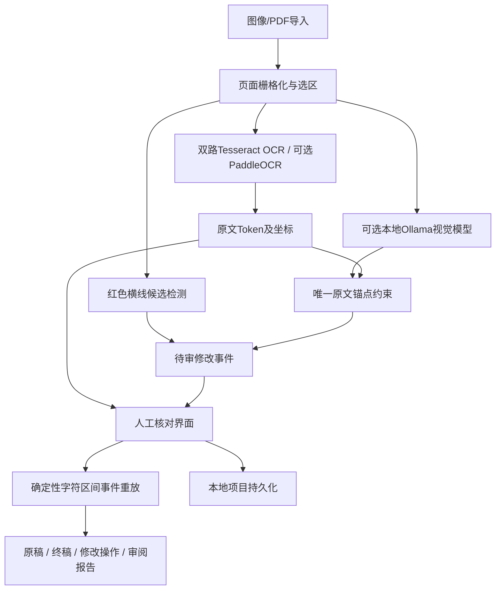

# ManuscriptRestorer 1.0 技术规格与研究路线

## 研究问题

对于带有人工增删、划除、替换和边注的手稿，传统OCR通常只能给出一个不确定的文本版本，丢失作者的编辑意图。我们将“原稿转写”和“编辑操作”分为两个不可混淆的数据层，并让所有自动预测先进入待审核池。

## 架构



## 数据模式

单个页面 `page = { id, name, image, tokens, edits, visionReview? }`。

文字片段示例：

```json
{"id":"t1","text":"今天天气很好","bbox":[10,20,180,50],"line":0,"order":0,"confidence":0.85,"source":"tesseract-dual"}
```

修改事件示例：

```json
{"id":"e1","op":"replace","target_id":"t1","span":[4,6],"text":"不错","status":"confirmed","source":"human-reviewed","bbox":[95,5,135,20]}
```

- `span = [start,end]` 是原文字的 **Unicode码点偏移**，不是字节偏移；JavaScript 对非 BMP 字符（如部分 emoji）使用 UTF-16 计数，若手稿包含此类字符，应先拆分成不跨代理项的文字框或进一步升级界面索引逻辑。
- `replace/delete` 的跨度不允许为空；`insert_before/insert_after` 使用 `[pos,pos]`。
- 两个已确认删除/替换的字符区间若重叠，会明确报错。
- 插入点位于删除/替换区间的**内部**时也会报错，但位于区间边界允许。
- 只有 `status = confirmed` 参与重建；`proposed/rejected` 不修改终稿。
- `bbox` 用于证据回溯，不能代替人工确认。

## 双路OCR

Tesseract 对彩色修改稿可能出现两类不同错误：原色图像中的红色边注被当正文；去红后的原文笔画断裂。我们分别运行原图和红色像素掩码图，按垂直位置对齐文本行，采用行级置信度选择较优版本，并排除具有明显红墨水特征的行。此策略属于**启发式方法**，尚未在独立手写数据集上证明优于单路OCR，不可夸大。

## 编辑关系推断

1. 红色横线：颜色分割，按候选文字框的中部水平线判断长条连通笔迹，几何近似映射到字串范围。每条建议置信度上限0.65，不直接确认。
2. 视觉模型：本地Ollama输出含原文短片段、操作类型、新文字和视觉证据的 JSON。只有原文短片段在OCR中**恰好匹配一次**时才绑定到文字框；否则保留在 `unmatched` 供人工审阅。
3. 审核：用户可以更正OCR、修正候选原文、调整新文字、确认或拒绝。
4. 重建：将已确认的区间操作按文字原文的起止位置排列，先输出对应插入，再输出保留文字或替换结果；不依赖自然语言模型决定最终结果。

## 测试结果（本次执行环境）

- 自动化测试覆盖 Unicode 区间操作、不同编辑类型、重叠检测、未确认事件、跨页合并、真实 Tesseract OCR 调用、合成红线检测、基于 pypdfium2 的 PDF 栅格化、HTTP 接口和本地项目持久化。
- 示例的原稿和终稿与预设标准答案逐字一致，属于**规则重建引擎**的正确性验证，不是OCR准确率。
- 浏览器无法直接访问容器内HTTP监听端口；使用 Playwright 加载同一页面脚本，并通过受控桥接连接真实后端，验证加载演示、生成终稿、添加划线建议和保存/读取项目；该方法不能替代 Windows 用户环境的浏览器验收。

## 下一阶段科学评测

建议在得到使用者授权、并脱敏后采集至少50张真实中文手写修改稿，按以下标签标注：

- 原文字符级真实答案（无法辨认的内容明确标注不确定）
- 每个修改的 `op`、原文跨度、替换/插入内容
- 修改笔迹的实际位置与文本锚点
- 不同笔色、不同笔迹者、拍照角度与分辨率

预先固定训练/开发/测试划分，禁止用测试集调整阈值。对比实验：

| 指标 | 作用 |
|---|---|
| CER（字符错误率） | 原文OCR的删、插、替错误总和 / 参考长度 |
| Edit Precision / Recall / F1 | 文字范围和操作类型均正确才算有效编辑 |
| 终稿CER | 应用编辑后与真实终稿的差距 |
| 审阅耗时 | 人工核对一页所需时长 |
| 证据定位IoU | 修改标记区域与人工框的重叠程度 |
| 歧义拒识率 | 无足够证据时能否正确返回“不确定” |

不以自然语言模型主观判断“看起来不错”代替定量验收。

## 外部研究资料

- 2026年关于划除文字与手写识别的研究：https://link.springer.com/article/10.1007/s10032-026-00603-8
- PaddleOCR官方OCR管线：https://www.paddleocr.ai/latest/en/version3.x/pipeline_usage/OCR.html
- Tesseract页面分割和图像质量：https://tesseract-ocr.github.io/tessdoc/ImproveQuality.html
- Ollama Qwen3-VL模型：https://ollama.com/library/qwen3-vl
